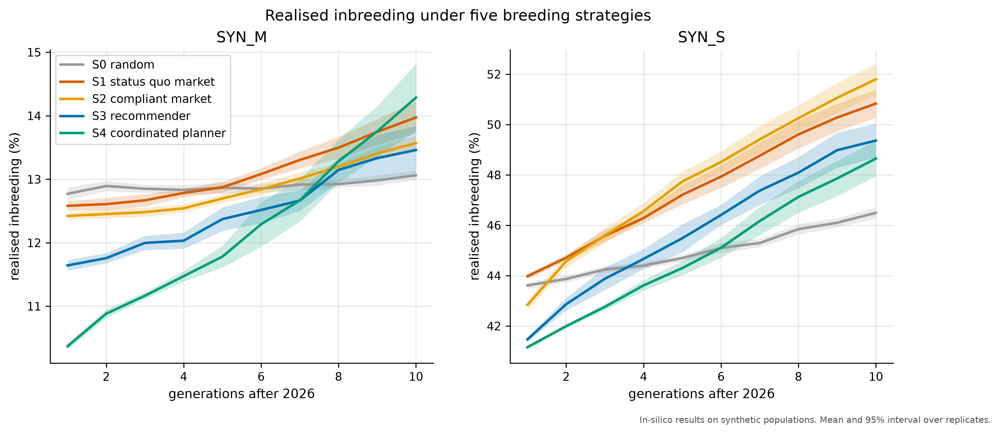
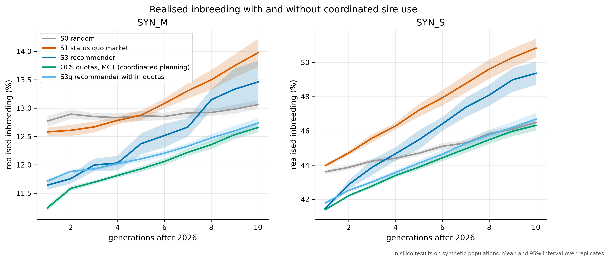
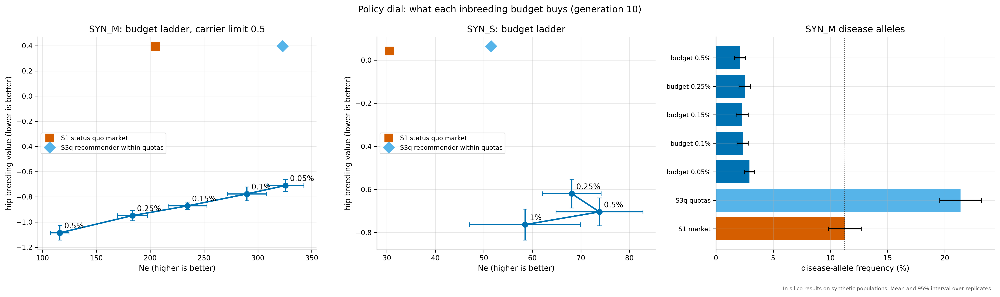

# Breeding Smarter

**A data-driven matching system for genetic diversity in dogs and beyond.**

[](https://github.com/TeaTisaj/breeding-smarter/actions)
**Live demo:** https://breeding-smarter.streamlit.app/ · Dataset and demo data: [release v0.1.0](https://github.com/TeaTisaj/breeding-smarter/releases/tag/v0.1.0)

> **Synthetic data notice.** Every animal, kennel, registration number and microchip in this
> project is synthetic. Nothing here describes a real dog. All results are in silico.

Kennel clubs today have lookup tools (what is this dog's COI?), not decision tools (which mate
best protects this breed?). We built an open, explainable, rule-aware matching engine and a
realistic synthetic benchmark to prove it, and we are looking for partners with real data.

## What is in the repository
- **Pedigree engine** (`breeding_smarter.pedigree`): inbreeding (Meuwissen and Luo), kinship
  products without forming A (Colleau), an exact additive explanation of a pair's inbreeding by
  ancestor, mean kinship, gene diversity, Ne (two methods), founder statistics, completeness.
- **Simulator** (`breeding_smarter.sim`): a seeded, calibrated synthetic registry of three dog
  breeds (1935 to 2026) with a separate ground truth.
- **Rule engine** (`breeding_smarter.rules`): EU Regulation 2026/1818, FCI, Kennel Club UK,
  Raad van Beheer and HKS profiles in YAML, each rule with its source and verification status.
- **Recommender** (`breeding_smarter.matching`): explainable multi-factor score cards for every
  candidate sire (inbreeding, diversity, Mendelian risk, HD breeding value, sire use, depth).
- **Club planner** (`breeding_smarter.coordination`): yearly litter quotas per sire by optimum
  contribution selection, mate allocation within quotas (`bsm coordinate`, app page "Club
  planner"). Method and parameters: `docs/coordination.md`.
- **Experiments** (`breeding_smarter.experiments`): 10-generation strategy comparisons.
- **Demo app** (`app/`, Streamlit).

## Quickstart
```bash
uv sync --all-groups
uv run bsm --help
uv run bsm generate --config configs/sim/tiny.yaml --out data/generated   # seconds
uv run bsm validate --run <run id> --targets configs/calibration/targets_tiny.yaml
uv run bsm generate                                        # full dataset (about 1 minute)
uv run bsm match --dataset <run id> --dam <reg_no>         # ranked sires for a dam
uv run bsm export demo-bundle --dataset <run id>
uv run streamlit run app/Home.py                           # demo app
```
Checks: `scripts/check.sh` (ruff, mypy, pytest).

## Headline result (in silico)


*Realised inbreeding over 10 generations under five breeding strategies (mean and 95%
interval over replicates). In-silico results on synthetic populations.* The recommender cuts
disease risk and short-term COI and improves hips; long-term diversity needs coordinated use
of sires. Details: `reports/experiments/E1_headline/summary.md`.

### Coordination


*In-silico results on synthetic populations.* A club planner that sets yearly litter quotas per
sire (optimum contribution selection) and lets matings happen within them raised Ne over the
status-quo market from 33 to 54 in the small breed and from 188 to
283 in the medium breed (generations 5 to 10), and beat the recommender alone; criteria
were fixed before running. Least-related mating without quotas was the worst strategy, and
random mating still kept more diversity in the medium breed. Details:
`reports/experiments/P12_hypotheses/hypotheses.md`, `plan/gates/P12_report.md`.

### Health and hips inside club quotas (E8 to E10)


*In-silico results on synthetic populations.* Club quotas planned with a hips budget
(inbreeding rise at most 0.1% per generation) and a carrier limit beat the simulated
status-quo market on diversity, hips and tested disease-allele frequency at once in the medium
breed (Ne +85, 95% interval +48 to +122; hip breeding value -1.17; disease-allele frequency
-8.9 points), replicated on an independent seed. The club chooses the budget: higher budgets buy
better hips at a diversity cost. Pre-registered criteria, including two that failed (the carrier
limit needs most breeders to take part; true-kinship planning did not raise Ne here):
`plan/gates/E8_report.md`, `plan/gates/E9_report.md`.

## Dataset
- GitHub release [v0.1.0](https://github.com/TeaTisaj/breeding-smarter/releases/tag/v0.1.0): `breeding-smarter-synthetic-v1.zip` (CC BY 4.0).
- Datasheet: `docs/datasheet.md`; data dictionary: `docs/data_dictionary.md`;
  validation: `reports/validation/20261011-default-s42/validation_report.md`.

## How to cite
See `CITATION.cff`.

## Licence
Code: Apache-2.0 (`LICENSE`). Generated datasets: CC BY 4.0 (`LICENSE-DATA`).

## Roadmap (after the conference)
- Django REST API and Postgres, multi-tenant for kennel clubs, on-premises option ("code goes
  to the data").
- Real-data pilots with breed clubs and kennel clubs.
- Genomic kinship import, metafounders, BLUP from real data.
- Optimum contribution selection and a breed-club planning view.
- Explanations in plain language constrained to the computed score cards.
- Horse and cat profiles validated with partners.

## Partner with us
Kennel and breed clubs: a free pilot gives you a diversity report for one breed, a compliance
check against EU 2026/1818 and mate recommendations; the code can run on your premises so no
data leaves the club. Contact: Tea Ćetojević Tisaj and Marija Perković, University of Zagreb FER.

## Acknowledgements
University of Zagreb, Faculty of Electrical Engineering and Computing (FER).
