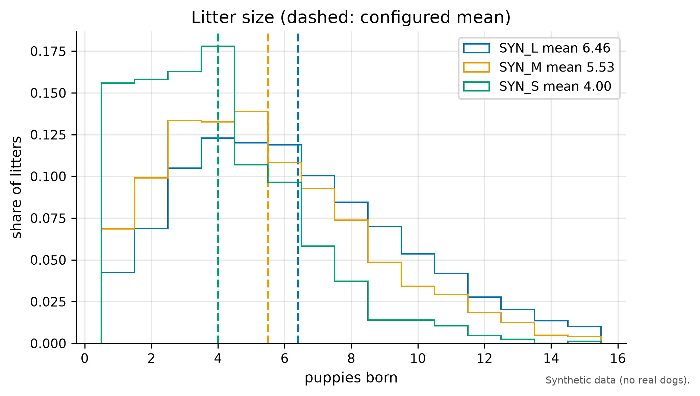
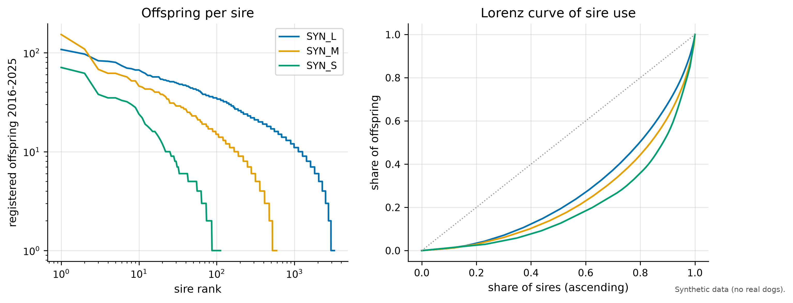
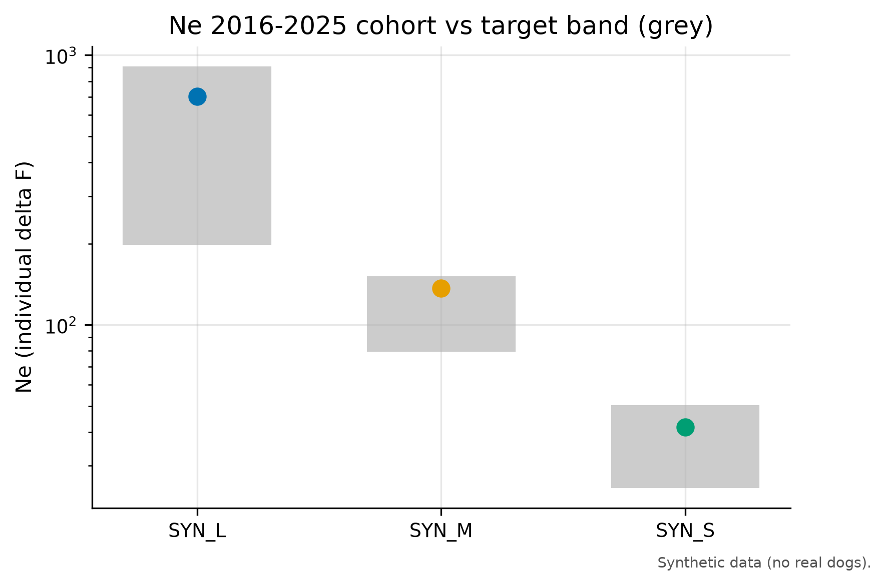
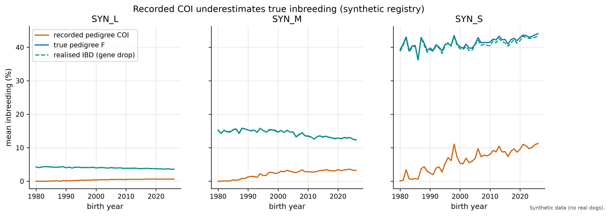
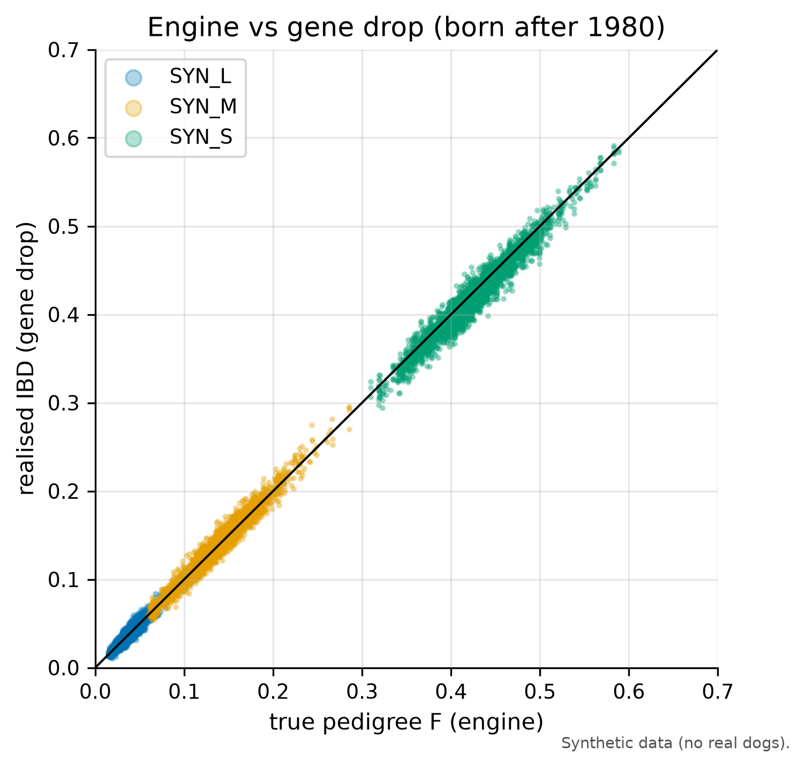
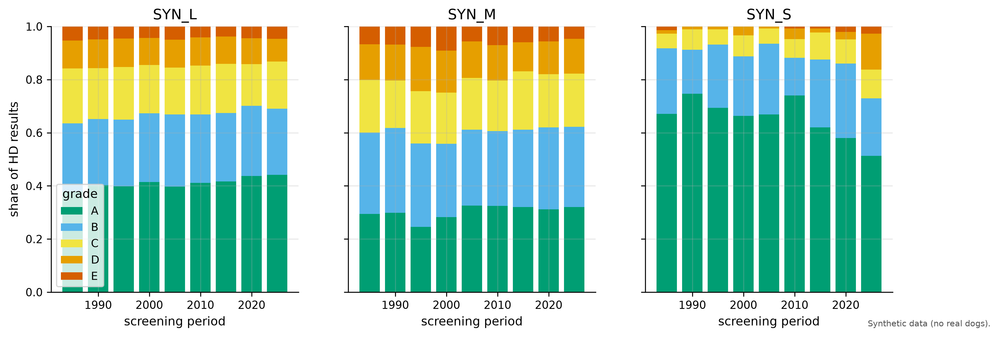
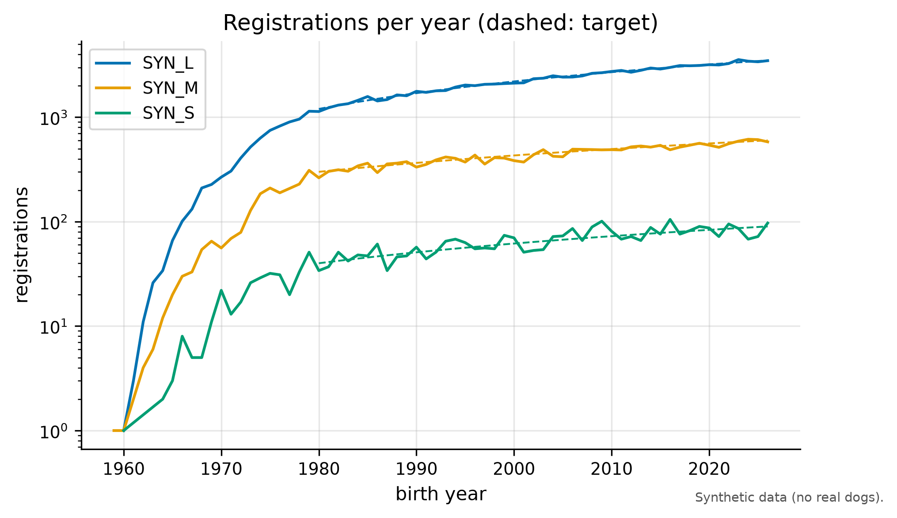
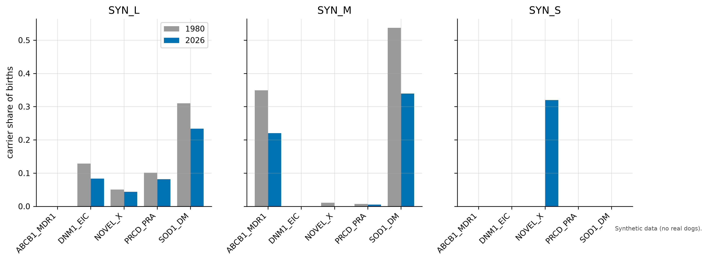

# Validation report: 20261011-default-s42

All animals in this dataset are synthetic.

Run `20261011-default-s42`: seed 42, config hash `68d359489162`, git `d3fddf8f31fb`, scale 1.0.

Checks: **39 PASS, 8 WARN, 0 FAIL** (58 report-only values). Hard targets must pass; soft targets warn only.

| id | kind | breed | component | simulated | target | status | source |
|---|---|---|---|---|---|---|---|
| T01 | hard | SYN_L | deviation_from_config | 0.05937 | [-0.3, 0.3] | PASS | borge-2011 |
| T01 | hard | SYN_L | mean | 6.459 | [3.5, 7.1] | PASS | borge-2011 |
| T01 | hard | SYN_M | deviation_from_config | 0.02862 | [-0.3, 0.3] | PASS | borge-2011 |
| T01 | hard | SYN_M | mean | 5.529 | [3.5, 7.1] | PASS | borge-2011 |
| T01 | hard | SYN_S | deviation_from_config | 0.00232 | [-0.3, 0.3] | PASS | borge-2011 |
| T01 | hard | SYN_S | mean | 4.002 | [3.5, 7.1] | PASS | borge-2011 |
| T02 | soft | SYN_L | share | 0.2689 | [0.196, 0.296] | PASS | tonnessen-2012 |
| T02 | soft | SYN_M | share | 0.2282 | [0.196, 0.296] | PASS | tonnessen-2012 |
| T02 | soft | SYN_S | share | 0.1914 | [0.196, 0.296] | WARN | tonnessen-2012 |
| T03 | soft | SYN_L | share | 0.1544 | [0.1, 0.3] | PASS | calboli-2008 |
| T03 | soft | SYN_M | share | 0.1524 | [0.1, 0.3] | PASS | calboli-2008 |
| T03 | soft | SYN_S | share | 0.196 | [0.1, 0.3] | PASS | calboli-2008 |
| T04 | soft | SYN_L | share | 0.1507 | [0.02, 0.2] | PASS | kc-demography-2025 |
| T04 | soft | SYN_M | share | 0.1316 | [0.02, 0.2] | PASS | kc-demography-2025 |
| T04 | soft | SYN_S | share | 0.1505 | [0.02, 0.2] | PASS | kc-demography-2025 |
| T05 | soft | SYN_L | share | 0.4961 | [0.4, 1] | PASS | haynes-1915 |
| T05 | soft | SYN_M | share | 0.5569 | [0.4, 1] | PASS | haynes-1915 |
| T05 | soft | SYN_S | share | 0.6366 | [0.4, 1] | PASS | haynes-1915 |
| T06 | soft | SYN_M | any_above | False | = True | WARN | leroy-rognon-2012 |
| T06 | soft | SYN_S | any_above | True | = True | PASS | leroy-rognon-2012 |
| T07 | hard | SYN_L | ne | 702.8 | [200, 900] | PASS | lewis-2015 |
| T07 | hard | SYN_M | ne | 136.7 | [80, 150] | PASS | lewis-2015 |
| T07 | hard | SYN_S | ne | 41.79 | [25, 50] | PASS | lewis-2015 |
| T08 | report | SYN_L | ne | 6191 |  | REPORT | fkc-strategy |
| T08 | report | SYN_L | n_sires | 3093 |  | REPORT | fkc-strategy |
| T08 | report | SYN_L | n_dams | 3098 |  | REPORT | fkc-strategy |
| T08 | report | SYN_L | fkc_flag_le_200 | False |  | REPORT | fkc-strategy |
| T08 | report | SYN_M | ne | 1193 |  | REPORT | fkc-strategy |
| T08 | report | SYN_M | n_sires | 564 |  | REPORT | fkc-strategy |
| T08 | report | SYN_M | n_dams | 633 |  | REPORT | fkc-strategy |
| T08 | report | SYN_M | fkc_flag_le_200 | False |  | REPORT | fkc-strategy |
| T08 | report | SYN_S | ne | 248.2 |  | REPORT | fkc-strategy |
| T08 | report | SYN_S | n_sires | 103 |  | REPORT | fkc-strategy |
| T08 | report | SYN_S | n_dams | 156 |  | REPORT | fkc-strategy |
| T08 | report | SYN_S | fkc_flag_le_200 | False |  | REPORT | fkc-strategy |
| T09 | soft | SYN_L | overall | 4.961 | [4, 5] | PASS | assumption |
| T09 | soft | SYN_M | overall | 5.076 | [4, 5] | WARN | assumption |
| T09 | soft | SYN_S | overall | 5.072 | [4, 5] | WARN | assumption |
| T10 | soft | SYN_L | early_higher | False | = True | WARN | lewis-2015 |
| T10 | soft | SYN_M | early_higher | True | = True | PASS | lewis-2015 |
| T10 | soft | SYN_S | early_higher | False | = True | WARN | lewis-2015 |
| T11 | hard | SYN_L | recorded_lower | True | = True | PASS | pde-2011 |
| T11 | hard | SYN_M | recorded_lower | True | = True | PASS | pde-2011 |
| T11 | hard | SYN_S | recorded_lower | True | = True | PASS | pde-2011 |
| T12 | hard | SYN_L | max_abs_diff | 9.158e-05 | [0, 0.01] | PASS | assumption |
| T12 | hard | SYN_M | max_abs_diff | 0.001112 | [0, 0.01] | PASS | assumption |
| T12 | hard | SYN_S | max_abs_diff | 0.007503 | [0, 0.01] | PASS | assumption |
| T13 | hard | SYN_L | slope | 0.9951 | [0.9, 1.1] | PASS | assumption |
| T13 | hard | SYN_L | intercept | 0.0001459 | [-0.01, 0.01] | PASS | assumption |
| T13 | hard | SYN_M | slope | 1.003 | [0.9, 1.1] | PASS | assumption |
| T13 | hard | SYN_M | intercept | 0.0004266 | [-0.01, 0.01] | PASS | assumption |
| T13 | hard | SYN_S | slope | 0.9905 | [0.9, 1.1] | PASS | assumption |
| T13 | hard | SYN_S | intercept | -0.00191 | [-0.01, 0.01] | PASS | assumption |
| T14 | soft | SYN_L | decreased | True | = True | PASS | skk-hd-2020 |
| T14 | soft | SYN_M | decreased | True | = True | PASS | skk-hd-2020 |
| T14 | soft | SYN_S | decreased | False | = True | WARN | skk-hd-2020 |
| T15 | soft | SYN_L | abs_gap | 0.09019 | [0, 0.1] | PASS | assumption |
| T15 | soft | SYN_M | abs_gap | 0.09868 | [0, 0.1] | PASS | assumption |
| T15 | soft | SYN_S | abs_gap | 0.2172 | [0, 0.1] | WARN | assumption |
| T17 | report | SYN_L | mean_ibd | 0.03583 |  | REPORT | bannasch-2021 |
| T17 | report | SYN_L | published_genomic_median | 0.25 |  | REPORT | bannasch-2021 |
| T17 | report | SYN_M | mean_ibd | 0.1258 |  | REPORT | bannasch-2021 |
| T17 | report | SYN_M | published_genomic_median | 0.25 |  | REPORT | bannasch-2021 |
| T17 | report | SYN_S | mean_ibd | 0.43 |  | REPORT | bannasch-2021 |
| T17 | report | SYN_S | published_genomic_median | 0.25 |  | REPORT | bannasch-2021 |

## Targets

### T01 (hard, PASS): Mean litter size per breed (registry era): configured mean +/- 0.3 and inside 3.5 to 7.1

Source: `borge-2011`.

### T02 (soft, WARN): Share of litters with at least one perinatal loss: 24.6% +/- 5 percentage points

Source: `tonnessen-2012`.

### T03 (soft, PASS): Share of registered dogs born 2005 to 2015 with recorded offspring: 10% to 30%

Source: `calboli-2008`. Note: secondary summary of calboli-2008

### T04 (soft, PASS): Share of registered males born 2005 to 2015 that sired a litter: 2% to 20%

Source: `kc-demography-2025`. Note: one breed (Samoyed 1.7%), weak target

### T05 (soft, PASS): Share of puppies (2016 to 2025) sired by the top 20% of active sires: at least 40%

Source: `haynes-1915`. Note: historical source (terriers, 1915)

### T06 (soft, WARN): At least one sire above the FCI 5%-in-5-years threshold (windows ending 2020 and 2025): true for SYN_M and SYN_S, reported for SYN_L

Source: `leroy-rognon-2012`.

### T07 (hard, PASS): Ne by individual increase in inbreeding (recorded pedigree), 2016 to 2025 cohort

Source: `lewis-2015`.

### T08 (report, REPORT): Ne census (breeding animals), 2016 to 2025 cohort; FKC flag if at most 200

Source: `fkc-strategy`.

- SYN_L ne: 6191
- SYN_L n_sires: 3093
- SYN_L n_dams: 3098
- SYN_L fkc_flag_le_200: False
- SYN_M ne: 1193
- SYN_M n_sires: 564
- SYN_M n_dams: 633
- SYN_M fkc_flag_le_200: False
- SYN_S ne: 248.2
- SYN_S n_sires: 103
- SYN_S n_dams: 156
- SYN_S fkc_flag_le_200: False

### T09 (soft, WARN): Generation interval (2016 to 2025 cohort): 4 to 5 years

Source: `assumption`.

### T10 (soft, WARN): Rate of inbreeding per generation (true pedigree F) higher in 1985 to 1995 than in 2010 to 2020

Source: `lewis-2015`.

### T11 (hard, PASS): Recorded pedigree F < true pedigree F for the 2025 cohort

Source: `pde-2011`.

### T12 (hard, PASS): Engine vs gene drop: |mean f_true_ibd - mean true pedigree F| per birth decade under 0.01

Source: `assumption`. Note: internal validation

### T13 (hard, PASS): Regression of f_true_ibd on true pedigree F (born after 1980): slope 0.9 to 1.1, intercept within +/- 0.01

Source: `assumption`. Note: internal validation

### T14 (soft, WARN): HD: share of D and E grades decreases from the first 5 screening years to 2021 to 2025

Source: `skk-hd-2020`.

### T15 (soft, WARN): EBV quality: corr(EBV, TBV) within 0.1 of mean reported accuracy (screened candidates)

Source: `assumption`. Note: internal validation

### T16 (report, REPORT): Imports and missingness: share HUR, share imports, share unknown parents per decade

Source: `assumption`.

- SYN_L share_hur_last_decade: 0
- SYN_L share_import_last_decade: 0.005169
- SYN_L share_unknown_parent_last_decade: 0
- SYN_M share_hur_last_decade: 0
- SYN_M share_import_last_decade: 0.007184
- SYN_M share_unknown_parent_last_decade: 0
- SYN_S share_hur_last_decade: 0
- SYN_S share_import_last_decade: 0.02698
- SYN_S share_unknown_parent_last_decade: 0

### T17 (report, REPORT): Mean realised IBD of the 2025 cohort, next to the published genomic median of about 0.25 (bases differ)

Source: `bannasch-2021`.

- SYN_L mean_ibd: 0.03583
- SYN_L published_genomic_median: 0.25
- SYN_M mean_ibd: 0.1258
- SYN_M published_genomic_median: 0.25
- SYN_S mean_ibd: 0.43
- SYN_S published_genomic_median: 0.25

### T18 (report, REPORT): Risk-allele frequencies of registered births, 1980 vs 2026 (context for disease experiments)

Source: `assumption`. Note: added in P5: base frequencies are illustrative assumptions

- SYN_L ABCB1_MDR1_freq_1980: 0
- SYN_L ABCB1_MDR1_freq_2026: 0
- SYN_L DNM1_EIC_freq_1980: 0.06758
- SYN_L DNM1_EIC_freq_2026: 0.04357
- SYN_L NOVEL_X_freq_1980: 0.02534
- SYN_L NOVEL_X_freq_2026: 0.02387
- SYN_L PRCD_PRA_freq_1980: 0.05229
- SYN_L PRCD_PRA_freq_2026: 0.04127
- SYN_L SOD1_DM_freq_1980: 0.2184
- SYN_L SOD1_DM_freq_2026: 0.1257
- SYN_M ABCB1_MDR1_freq_1980: 0.21
- SYN_M ABCB1_MDR1_freq_2026: 0.1102
- SYN_M DNM1_EIC_freq_1980: 0
- SYN_M DNM1_EIC_freq_2026: 0
- SYN_M NOVEL_X_freq_1980: 0.005338
- SYN_M NOVEL_X_freq_2026: 0
- SYN_M PRCD_PRA_freq_1980: 0.003559
- SYN_M PRCD_PRA_freq_2026: 0.002582
- SYN_M SOD1_DM_freq_1980: 0.4217
- SYN_M SOD1_DM_freq_2026: 0.185
- SYN_S ABCB1_MDR1_freq_1980: 0
- SYN_S ABCB1_MDR1_freq_2026: 0
- SYN_S DNM1_EIC_freq_1980: 0
- SYN_S DNM1_EIC_freq_2026: 0
- SYN_S NOVEL_X_freq_1980: 0
- SYN_S NOVEL_X_freq_2026: 0.2113
- SYN_S PRCD_PRA_freq_1980: 0
- SYN_S PRCD_PRA_freq_2026: 0
- SYN_S SOD1_DM_freq_1980: 0
- SYN_S SOD1_DM_freq_2026: 0

