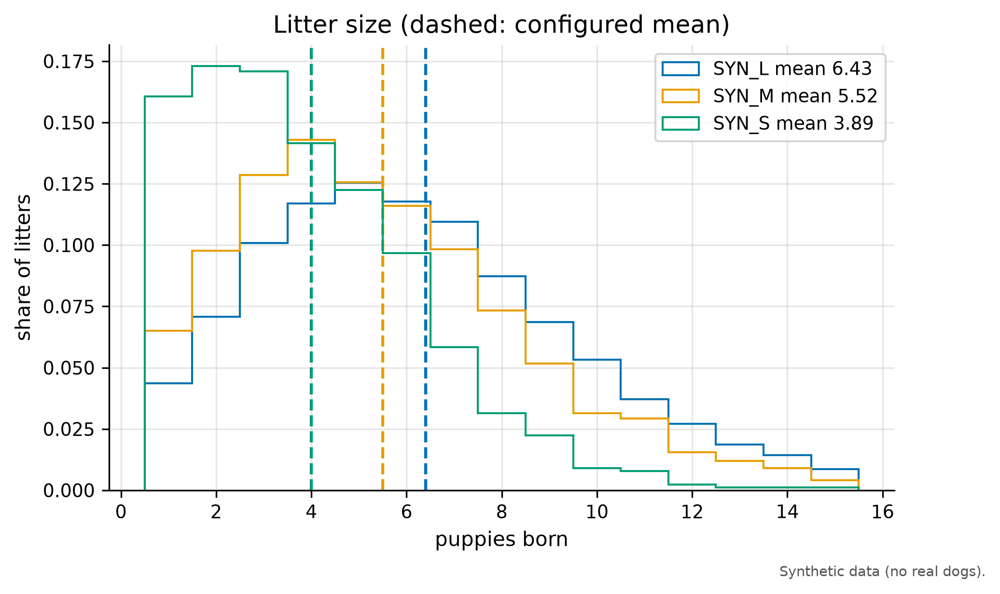
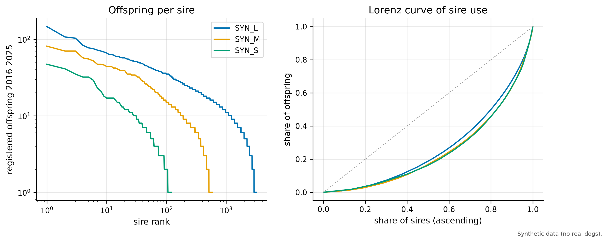
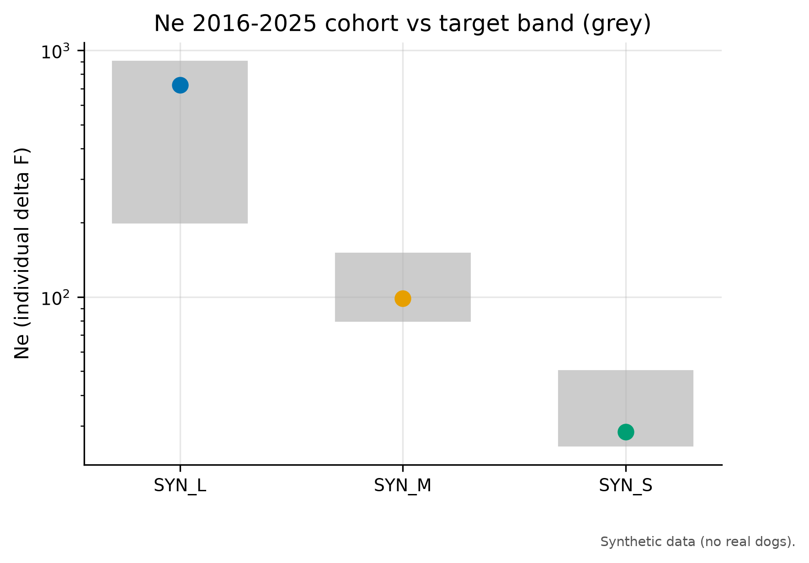
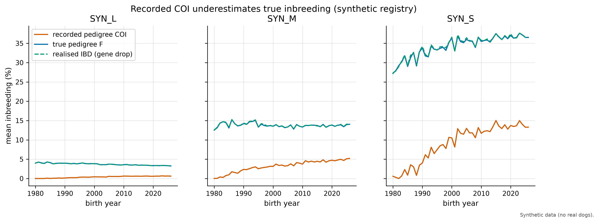
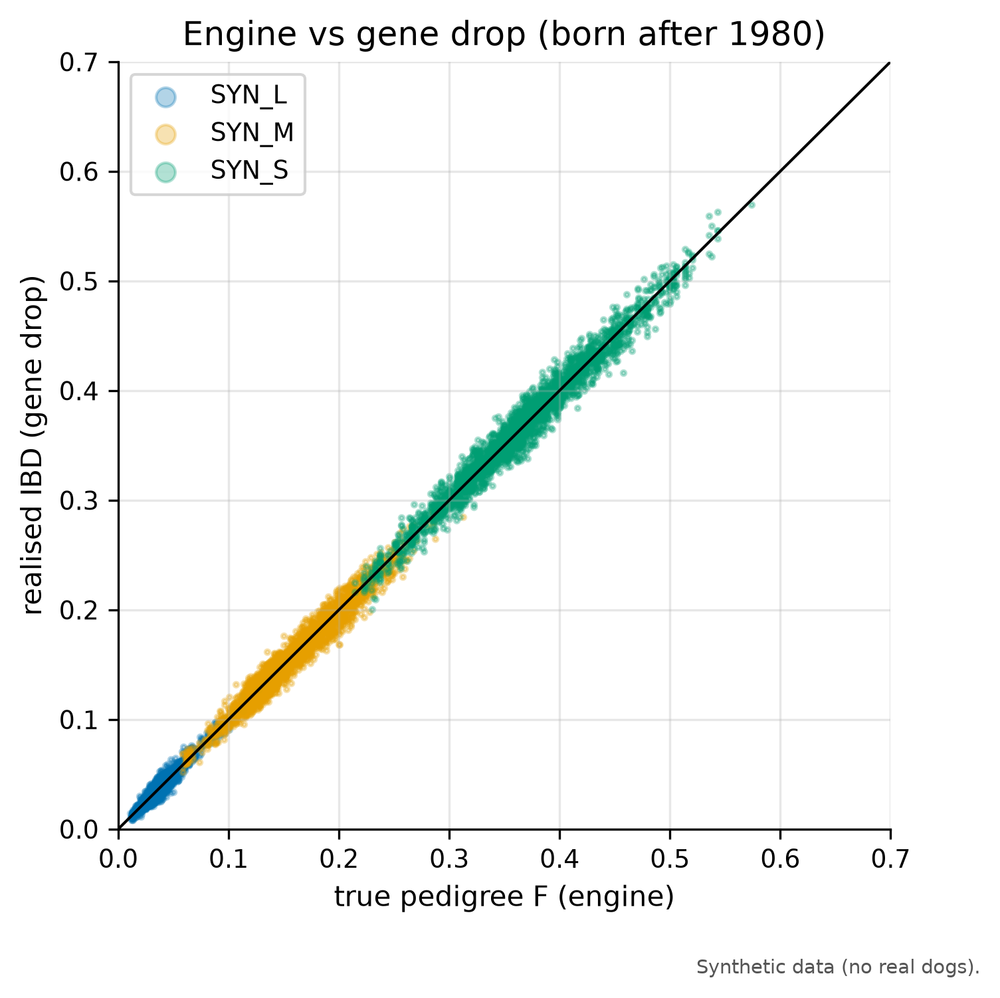
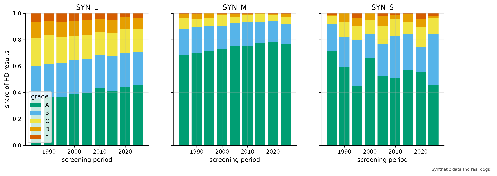
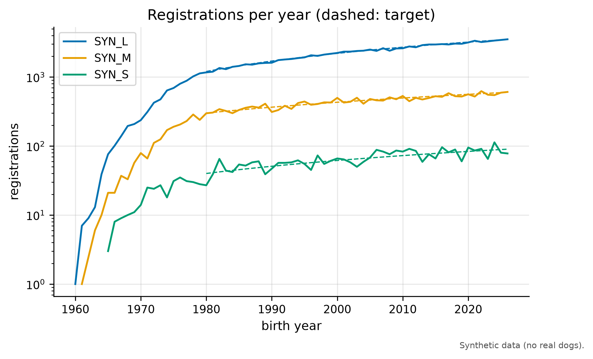
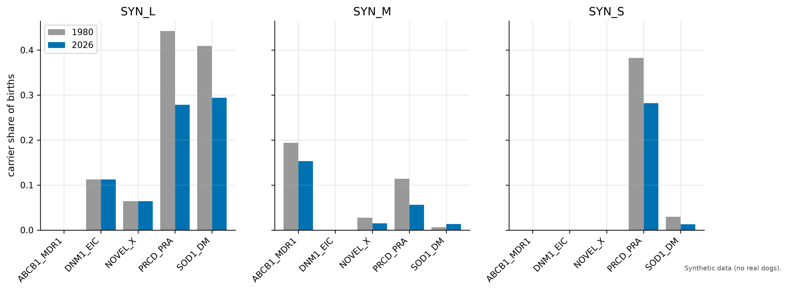

# Validation report: e11-default-s102

All animals in this dataset are synthetic.

Run `e11-default-s102`: seed 102, config hash `68d359489162`, git `20e1961c53c9`, scale 1.0.

Checks: **40 PASS, 7 WARN, 0 FAIL** (58 report-only values). Hard targets must pass; soft targets warn only.

| id | kind | breed | component | simulated | target | status | source |
|---|---|---|---|---|---|---|---|
| T01 | hard | SYN_L | deviation_from_config | 0.03113 | [-0.3, 0.3] | PASS | borge-2011 |
| T01 | hard | SYN_L | mean | 6.431 | [3.5, 7.1] | PASS | borge-2011 |
| T01 | hard | SYN_M | deviation_from_config | 0.02247 | [-0.3, 0.3] | PASS | borge-2011 |
| T01 | hard | SYN_M | mean | 5.522 | [3.5, 7.1] | PASS | borge-2011 |
| T01 | hard | SYN_S | deviation_from_config | -0.109 | [-0.3, 0.3] | PASS | borge-2011 |
| T01 | hard | SYN_S | mean | 3.891 | [3.5, 7.1] | PASS | borge-2011 |
| T02 | soft | SYN_L | share | 0.2678 | [0.196, 0.296] | PASS | tonnessen-2012 |
| T02 | soft | SYN_M | share | 0.2422 | [0.196, 0.296] | PASS | tonnessen-2012 |
| T02 | soft | SYN_S | share | 0.1708 | [0.196, 0.296] | WARN | tonnessen-2012 |
| T03 | soft | SYN_L | share | 0.1497 | [0.1, 0.3] | PASS | calboli-2008 |
| T03 | soft | SYN_M | share | 0.1697 | [0.1, 0.3] | PASS | calboli-2008 |
| T03 | soft | SYN_S | share | 0.2076 | [0.1, 0.3] | PASS | calboli-2008 |
| T04 | soft | SYN_L | share | 0.1481 | [0.02, 0.2] | PASS | kc-demography-2025 |
| T04 | soft | SYN_M | share | 0.1396 | [0.02, 0.2] | PASS | kc-demography-2025 |
| T04 | soft | SYN_S | share | 0.1494 | [0.02, 0.2] | PASS | kc-demography-2025 |
| T05 | soft | SYN_L | share | 0.5 | [0.4, 1] | PASS | haynes-1915 |
| T05 | soft | SYN_M | share | 0.542 | [0.4, 1] | PASS | haynes-1915 |
| T05 | soft | SYN_S | share | 0.5402 | [0.4, 1] | PASS | haynes-1915 |
| T06 | soft | SYN_M | any_above | False | = True | WARN | leroy-rognon-2012 |
| T06 | soft | SYN_S | any_above | True | = True | PASS | leroy-rognon-2012 |
| T07 | hard | SYN_L | ne | 724.5 | [200, 900] | PASS | lewis-2015 |
| T07 | hard | SYN_M | ne | 98.47 | [80, 150] | PASS | lewis-2015 |
| T07 | hard | SYN_S | ne | 28.45 | [25, 50] | PASS | lewis-2015 |
| T08 | report | SYN_L | ne | 6026 |  | REPORT | fkc-strategy |
| T08 | report | SYN_L | n_sires | 3048 |  | REPORT | fkc-strategy |
| T08 | report | SYN_L | n_dams | 2979 |  | REPORT | fkc-strategy |
| T08 | report | SYN_L | fkc_flag_le_200 | False |  | REPORT | fkc-strategy |
| T08 | report | SYN_M | ne | 1233 |  | REPORT | fkc-strategy |
| T08 | report | SYN_M | n_sires | 552 |  | REPORT | fkc-strategy |
| T08 | report | SYN_M | n_dams | 698 |  | REPORT | fkc-strategy |
| T08 | report | SYN_M | fkc_flag_le_200 | False |  | REPORT | fkc-strategy |
| T08 | report | SYN_S | ne | 261.7 |  | REPORT | fkc-strategy |
| T08 | report | SYN_S | n_sires | 116 |  | REPORT | fkc-strategy |
| T08 | report | SYN_S | n_dams | 150 |  | REPORT | fkc-strategy |
| T08 | report | SYN_S | fkc_flag_le_200 | False |  | REPORT | fkc-strategy |
| T09 | soft | SYN_L | overall | 4.882 | [4, 5] | PASS | assumption |
| T09 | soft | SYN_M | overall | 5.139 | [4, 5] | WARN | assumption |
| T09 | soft | SYN_S | overall | 5.195 | [4, 5] | WARN | assumption |
| T10 | soft | SYN_L | early_higher | True | = True | PASS | lewis-2015 |
| T10 | soft | SYN_M | early_higher | False | = True | WARN | lewis-2015 |
| T10 | soft | SYN_S | early_higher | True | = True | PASS | lewis-2015 |
| T11 | hard | SYN_L | recorded_lower | True | = True | PASS | pde-2011 |
| T11 | hard | SYN_M | recorded_lower | True | = True | PASS | pde-2011 |
| T11 | hard | SYN_S | recorded_lower | True | = True | PASS | pde-2011 |
| T12 | hard | SYN_L | max_abs_diff | 0.0001457 | [0, 0.01] | PASS | assumption |
| T12 | hard | SYN_M | max_abs_diff | 0.001105 | [0, 0.01] | PASS | assumption |
| T12 | hard | SYN_S | max_abs_diff | 0.001867 | [0, 0.01] | PASS | assumption |
| T13 | hard | SYN_L | slope | 1.003 | [0.9, 1.1] | PASS | assumption |
| T13 | hard | SYN_L | intercept | -0.0002084 | [-0.01, 0.01] | PASS | assumption |
| T13 | hard | SYN_M | slope | 0.9726 | [0.9, 1.1] | PASS | assumption |
| T13 | hard | SYN_M | intercept | 0.003811 | [-0.01, 0.01] | PASS | assumption |
| T13 | hard | SYN_S | slope | 0.9867 | [0.9, 1.1] | PASS | assumption |
| T13 | hard | SYN_S | intercept | 0.00573 | [-0.01, 0.01] | PASS | assumption |
| T14 | soft | SYN_L | decreased | True | = True | PASS | skk-hd-2020 |
| T14 | soft | SYN_M | decreased | True | = True | PASS | skk-hd-2020 |
| T14 | soft | SYN_S | decreased | False | = True | WARN | skk-hd-2020 |
| T15 | soft | SYN_L | abs_gap | 0.06038 | [0, 0.1] | PASS | assumption |
| T15 | soft | SYN_M | abs_gap | 0.1808 | [0, 0.1] | WARN | assumption |
| T15 | soft | SYN_S | abs_gap | 0.08613 | [0, 0.1] | PASS | assumption |
| T17 | report | SYN_L | mean_ibd | 0.03327 |  | REPORT | bannasch-2021 |
| T17 | report | SYN_L | published_genomic_median | 0.25 |  | REPORT | bannasch-2021 |
| T17 | report | SYN_M | mean_ibd | 0.1408 |  | REPORT | bannasch-2021 |
| T17 | report | SYN_M | published_genomic_median | 0.25 |  | REPORT | bannasch-2021 |
| T17 | report | SYN_S | mean_ibd | 0.3654 |  | REPORT | bannasch-2021 |
| T17 | report | SYN_S | published_genomic_median | 0.25 |  | REPORT | bannasch-2021 |

## Targets

### T01 (hard, PASS): Mean litter size per breed (registry era): configured mean +/- 0.3 and inside 3.5 to 7.1

Source: `borge-2011`.

### T02 (soft, WARN): Share of litters with at least one perinatal loss: 24.6% +/- 5 percentage points

Source: `tonnessen-2012`.

### T03 (soft, PASS): Share of registered dogs born 2005 to 2015 with recorded offspring: 10% to 30%

Source: `calboli-2008`. Note: secondary summary of calboli-2008

### T04 (soft, PASS): Share of registered males born 2005 to 2015 that sired a litter: 2% to 20%

Source: `kc-demography-2025`. Note: one breed (Samoyed 1.7%), weak target

### T05 (soft, PASS): Share of puppies (2016 to 2025) sired by the top 20% of active sires: at least 40%

Source: `haynes-1915`. Note: historical source (terriers, 1915)

### T06 (soft, WARN): At least one sire above the FCI 5%-in-5-years threshold (windows ending 2020 and 2025): true for SYN_M and SYN_S, reported for SYN_L

Source: `leroy-rognon-2012`.

### T07 (hard, PASS): Ne by individual increase in inbreeding (recorded pedigree), 2016 to 2025 cohort

Source: `lewis-2015`.

### T08 (report, REPORT): Ne census (breeding animals), 2016 to 2025 cohort; FKC flag if at most 200

Source: `fkc-strategy`.

- SYN_L ne: 6026
- SYN_L n_sires: 3048
- SYN_L n_dams: 2979
- SYN_L fkc_flag_le_200: False
- SYN_M ne: 1233
- SYN_M n_sires: 552
- SYN_M n_dams: 698
- SYN_M fkc_flag_le_200: False
- SYN_S ne: 261.7
- SYN_S n_sires: 116
- SYN_S n_dams: 150
- SYN_S fkc_flag_le_200: False

### T09 (soft, WARN): Generation interval (2016 to 2025 cohort): 4 to 5 years

Source: `assumption`.

### T10 (soft, WARN): Rate of inbreeding per generation (true pedigree F) higher in 1985 to 1995 than in 2010 to 2020

Source: `lewis-2015`.

### T11 (hard, PASS): Recorded pedigree F < true pedigree F for the 2025 cohort

Source: `pde-2011`.

### T12 (hard, PASS): Engine vs gene drop: |mean f_true_ibd - mean true pedigree F| per birth decade under 0.01

Source: `assumption`. Note: internal validation

### T13 (hard, PASS): Regression of f_true_ibd on true pedigree F (born after 1980): slope 0.9 to 1.1, intercept within +/- 0.01

Source: `assumption`. Note: internal validation

### T14 (soft, WARN): HD: share of D and E grades decreases from the first 5 screening years to 2021 to 2025

Source: `skk-hd-2020`.

### T15 (soft, WARN): EBV quality: corr(EBV, TBV) within 0.1 of mean reported accuracy (screened candidates)

Source: `assumption`. Note: internal validation

### T16 (report, REPORT): Imports and missingness: share HUR, share imports, share unknown parents per decade

Source: `assumption`.

- SYN_L share_hur_last_decade: 0
- SYN_L share_import_last_decade: 0.004863
- SYN_L share_unknown_parent_last_decade: 0
- SYN_M share_hur_last_decade: 0
- SYN_M share_import_last_decade: 0.007927
- SYN_M share_unknown_parent_last_decade: 0
- SYN_S share_hur_last_decade: 0
- SYN_S share_import_last_decade: 0.02093
- SYN_S share_unknown_parent_last_decade: 0

### T17 (report, REPORT): Mean realised IBD of the 2025 cohort, next to the published genomic median of about 0.25 (bases differ)

Source: `bannasch-2021`.

- SYN_L mean_ibd: 0.03327
- SYN_L published_genomic_median: 0.25
- SYN_M mean_ibd: 0.1408
- SYN_M published_genomic_median: 0.25
- SYN_S mean_ibd: 0.3654
- SYN_S published_genomic_median: 0.25

### T18 (report, REPORT): Risk-allele frequencies of registered births, 1980 vs 2026 (context for disease experiments)

Source: `assumption`. Note: added in P5: base frequencies are illustrative assumptions

- SYN_L ABCB1_MDR1_freq_1980: 0
- SYN_L ABCB1_MDR1_freq_2026: 0
- SYN_L DNM1_EIC_freq_1980: 0.05708
- SYN_L DNM1_EIC_freq_2026: 0.05703
- SYN_L NOVEL_X_freq_1980: 0.03362
- SYN_L NOVEL_X_freq_2026: 0.03214
- SYN_L PRCD_PRA_freq_1980: 0.3323
- SYN_L PRCD_PRA_freq_2026: 0.1513
- SYN_L SOD1_DM_freq_1980: 0.2748
- SYN_L SOD1_DM_freq_2026: 0.1658
- SYN_M ABCB1_MDR1_freq_1980: 0.1062
- SYN_M ABCB1_MDR1_freq_2026: 0.07661
- SYN_M DNM1_EIC_freq_1980: 0
- SYN_M DNM1_EIC_freq_2026: 0
- SYN_M NOVEL_X_freq_1980: 0.01385
- SYN_M NOVEL_X_freq_2026: 0.007414
- SYN_M PRCD_PRA_freq_1980: 0.07231
- SYN_M PRCD_PRA_freq_2026: 0.02801
- SYN_M SOD1_DM_freq_1980: 0.003077
- SYN_M SOD1_DM_freq_2026: 0.00659
- SYN_S ABCB1_MDR1_freq_1980: 0
- SYN_S ABCB1_MDR1_freq_2026: 0
- SYN_S DNM1_EIC_freq_1980: 0
- SYN_S DNM1_EIC_freq_2026: 0
- SYN_S NOVEL_X_freq_1980: 0
- SYN_S NOVEL_X_freq_2026: 0
- SYN_S PRCD_PRA_freq_1980: 0.1912
- SYN_S PRCD_PRA_freq_2026: 0.141
- SYN_S SOD1_DM_freq_1980: 0.01471
- SYN_S SOD1_DM_freq_2026: 0.00641

